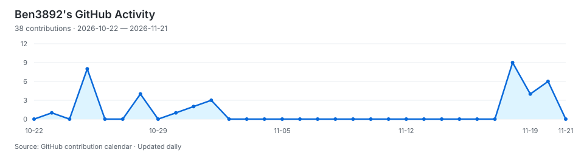

<h1>Ben (Jiangan) Yuan</h1>

<strong>大模型预训练与中训练 · 知识蒸馏 · 数据与评测</strong>

  <a href="https://ben3892.github.io/"><strong>个人主页</strong></a>
  &nbsp;·&nbsp;
  <a href="https://scholar.google.com/citations?user=hUOpBWsAAAAJ">Google Scholar</a>
  &nbsp;·&nbsp;
  <a href="mailto:jianganyuan@link.cuhk.edu.cn">邮件联系</a>

  <a href="#研究与项目">研究项目</a>
  &nbsp;/&nbsp;
  <a href="#开源实现">开源实现</a>
  &nbsp;/&nbsp;
  <a href="#工作与教育">工作与教育</a>

目前在百度搜索策略部参与 **100B 级 MoE 搜索大模型**的预训练与中训练。围绕训练目标、数据质量和能力评测，开展可复盘的对照实验。

## 研究与项目

### 蒸馏目标与监督信号选择

比较 **Forward KL 与 NTP 的领域能力差异**，设计领域条件目标路由，并从代理实验扩展到目标模型验证；进一步使用 1B Proxy 模型搜索 Top-k、Temperature 与损失权重等配置。

[蒸馏目标设计与规模化验证](https://ben3892.github.io/portfolio/llm-distillation-objectives/)

### 数学与代码数据质量闭环

连接**知识点驱动合成、分领域过滤、答案投票与沙箱校验**。通过等 Token 对照和错误归因，区分数据规模与质量收益，再针对薄弱能力调整数据。

[数学与代码数据合成—过滤—评测闭环](https://ben3892.github.io/portfolio/math-code-data-pipeline/)

### 搜索 Agent 数据与原子能力

结合 **Wikipedia、混合检索与实体图**构造多跳问题和轨迹，拆解查询改写、证据定位与状态转移，开展课程式中训练和原子能力评测，并结合后训练 SFT 与 BrowseComp 评估在线搜索能力。

[搜索 Agent 多跳推理数据合成](https://ben3892.github.io/portfolio/search-agent-data-synthesis/)

## 开源实现

### [题级评测与诊断闭环](https://github.com/Ben3892/data_evaluation_loop)

`data_evaluation_loop`

- **实现**：能力切片、`EvaluationResult`、`first_error` / `primary_error`、重复作答与正确性迁移；已接入 AIME 整数答案规范化、离线判分和 `pass@k`。
- **验证范围**：fixture 检查接口与统计，过程错误来自显式标注；完整榜单结果需另行验证。

### [最小预训练、SFT 与递归训练实验](https://github.com/Ben3892/nano_model_experiment_framework)

`nano_model_experiment_framework`

- **实现**：统一 PyTorch 与 Pai-Megatron-Patch 训练入口，支持带验证器的递归 SFT、A800 单卡/双卡 DP smoke 脚本及原生 Megatron checkpoint rollout。
- **验证范围**：PyTorch CPU 合成实验已有记录，真实 A800 验收待完成；verl / OPD 为后续计划。

### [搜索 Agent 离线检索环境](https://github.com/Ben3892/search_agent_environment)

`search_agent_environment`

- **实现**：BM25、Embedding/FAISS 与重排，提供 `/search`、`/search_chunks`、`/visit` 接口及部署说明。
- **验证范围**：完整 GPU 链路需在目标环境验证。

近期合并：[AIME 判分与 pass@k · 2026-11-20](https://github.com/Ben3892/data_evaluation_loop/pull/2) · [A800 验收脚本与 Megatron RSI 接入 · 2026-11-23](https://github.com/Ben3892/nano_model_experiment_framework/pull/2)。

## 工作与教育

**百度 · 搜索策略部** &nbsp; 2025.08 — 至今  
蒸馏目标设计、数学与代码数据策略、评测归因与搜索 Agent 数据合成。

<strong>展开工作职责与实验背景</strong>

从事大模型预训练与中训练，主要负责蒸馏目标设计、数学与代码数据策略、评测归因和搜索 Agent 数据合成。

- **预训练与中训练蒸馏目标**：完成裁剪后模型的离线 Forward KL 恢复训练，在代表性评测上保留 Teacher 约 **90+%** 的能力；分析 Forward KL 与下一 Token 预测（NTP）在不同领域的能力权衡，设计领域条件目标路由，并在代理模型与目标模型上验证。
- **数学与代码数据**：搭建合成、质量过滤、知识规则约束、多答案投票与沙箱执行校验的数据流水线，形成约 **100B级别 Token** 的有效训练数据；通过等 Token 对照实验与错误归因持续改进数据质量。
- **搜索 Agent**：基于 Wikipedia、BM25、向量召回、重排与实体图合成多跳问题和搜索轨迹，将查询改写、证据定位与状态转移等能力拆解为原子任务，开展课程式中训练与细粒度评测。
- **后训练跨词表蒸馏**：设计 off-policy KD 目标，对齐不同模型的输出分布，为跨词表 MOPD 提供热启模型。

**教育经历**

- **香港中文大学（深圳）** · 2023.09 — 2025.07
- **华南理工大学** · 2019.09 — 2023.07

## 技术与分享

<strong>工具、技术方向与阅读笔记</strong>

  <a href="https://skillicons.dev">
    <picture>
      <source media="(prefers-color-scheme: dark)" srcset="https://skillicons.dev/icons?i=py,pytorch,cpp,linux,bash,git,github,docker&amp;theme=dark&amp;perline=8" />
      
    </picture>
  </a>

  
  
  
  

- **模型训练**：LLM Pre-training、Mid-training、SFT、MoE、Knowledge Distillation、Forward KL、NTP。
- **数据与评测**：数据合成、质量过滤、沙箱校验、能力评测与错误归因、课程学习。
- **检索与 Agent**：BM25、Embedding、Reranking、实体图、多跳推理、Query Reformulation、Evidence Grounding。
- **训练系统**：分布式训练、CUDA、Triton、Kernel Fusion。

持续整理大模型训练与系统相关笔记，包括 Megatron-LM、verl 源码阅读，以及 Attention 机制、Attention Sink 和技术报告阅读。

<strong>GitHub 活跃度 · 统计与贡献动画</strong>

  <a href="https://github.com/Ben3892">
    <picture>
      <source media="(prefers-color-scheme: dark)" srcset="https://github-stats-extended.vercel.app/api?username=Ben3892&amp;show_icons=true&amp;theme=github_dark&amp;hide_border=true&amp;rank_icon=github" />
      
    </picture>
  </a>
  <a href="https://github.com/Ben3892?tab=repositories">
    <picture>
      <source media="(prefers-color-scheme: dark)" srcset="https://github-stats-extended.vercel.app/api/top-langs/?username=Ben3892&amp;layout=compact&amp;langs_count=6&amp;theme=github_dark&amp;hide_border=true" />
      
    </picture>
  </a>

<picture>
  <source media="(prefers-color-scheme: dark)" srcset="assets/github-activity-dark.svg" />
  
</picture>

<!-- .github/workflows/snake.yml 每天更新 assets 中的活跃度图和贡献动画。 -->
<picture>
  <source media="(prefers-color-scheme: dark)" srcset="assets/github-contribution-grid-snake-dark.svg" />
  
</picture>

---

欢迎围绕大模型训练、知识蒸馏、训练数据与可解释性交流：**[jianganyuan@link.cuhk.edu.cn](mailto:jianganyuan@link.cuhk.edu.cn)**。
